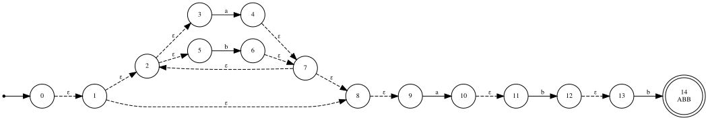
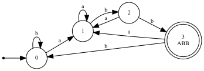
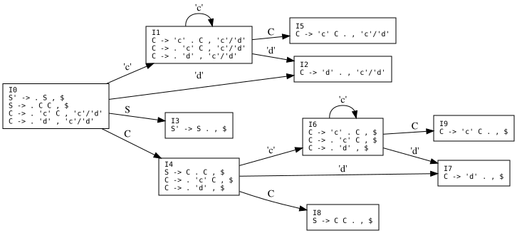
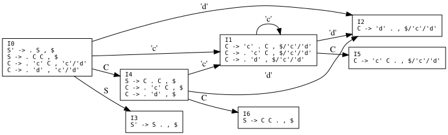

# LALRGen

A Lex/Yacc clone written in Java 21, built for a Theory of Computation and Compiler Design
project. From one spec file it generates:

* a **lexer**: regex → Thompson NFA → subset-construction DFA → Hopcroft-minimized DFA, run with
  maximal munch and token priorities;
* a **parser**: SLR(1), canonical LR(1) and LALR(1) tables, Yacc-style precedence and
  associativity, conflict reports with example inputs, an LR driver with traces, AST building and
  panic-mode error recovery.

All automata algorithms are implemented by hand (no ANTLR, JFlex, CUP, and no `java.util.regex`
in the engine). There are no runtime dependencies.

## Build and run

Needs Java 21+ and Maven 3.9+.

```bash
mvn package                       # compiles, runs all 189 tests, builds target/lalrgen.jar
java -jar target/lalrgen.jar --help
alias lalrgen='java -jar target/lalrgen.jar'   # optional
```

## Walkthrough

**1. Write a spec** (`examples/calc.lg`, abridged; the format is described in
[docs/SPEC_FORMAT.md](docs/SPEC_FORMAT.md)):

```
%token NUM   /[0-9]+(\.[0-9]+)?/
%token ID    /[a-zA-Z_][a-zA-Z0-9_]*/
%skip        /[ \t\r\n]+/
%left  '+' '-'
%left  '*' '/' '%'
%right UMINUS
%right '^'
%%
stmt : ID '=' expr ';'         -> Assign(Var($1), $3)
     | expr ';'                -> Print($1) ;
expr : expr '-' expr           -> Sub($1, $3)
     | expr '^' expr           -> Pow($1, $3)
     | '-' expr %prec UMINUS   -> Neg($2)
     | NUM                     -> Num($1)
     ...
```

**2. Check it**

```
$ lalrgen check examples/calc.lg
calc.lg: 13 terminals, 4 non-terminals, 15 productions, 14 lexer rules
Lexer: NFA 57 states, DFA 22 states, minimized DFA 17 states, 17 character classes
LALR: 30 states, 0 shift/reduce, 0 reduce/reduce conflict(s) (42 resolved by precedence)
```

**3. Look at the automata**

```bash
lalrgen dot examples/calc.lg --what mindfa -o mindfa.dot && dot -Tsvg mindfa.dot -o mindfa.svg
lalrgen dot examples/cc.lg --what lr1 -o lr1.dot      # also: nfa, dfa, lr0, lalr
lalrgen states examples/cc.lg --mode lr1              # item sets as text
lalrgen tables examples/expr.lg --mode slr            # ACTION / GOTO table
lalrgen sets examples/expr.lg                         # nullable, FIRST, FOLLOW
```

| Thompson NFA for `(a\|b)*abb` | Minimized DFA |
|---|---|
|  |  |

| LR(1) automaton (10 states) | LALR(1) after merging (7 states) |
|---|---|
|  |  |

**4. Parse and print the AST**

```
$ lalrgen parse examples/calc.lg examples/inputs/calc_ok.txt --ast
Program
  List
    Assign
      Var: ID "x"
      Sub                      <- 1 - 2 - 3 is (1 - 2) - 3
        Sub
          Num: NUM "1"
          Num: NUM "2"
        Num: NUM "3"
    Assign
      Var: ID "y"
      Pow                      <- 2 ^ 3 ^ 2 is 2 ^ (3 ^ 2)
      ...
```

Add `--trace` to see every shift and reduce, `--json` for JSON, or leave out `--ast` for the full
parse tree. Errors are reported with positions and the parser recovers to find more of them:

```
$ lalrgen parse examples/calc.lg examples/inputs/calc_bad.txt
calc_bad.txt:1:8: error: unexpected ';', expected one of: '-', '(', NUM, ID
calc_bad.txt:3:5: error: unexpected ')', expected one of: '-', '(', NUM, ID
calc_bad.txt:4:7: error: unexpected character "$"
calc_bad.txt:4:9: error: unexpected NUM "5", expected one of: ';', '+', '-', '*', '/', '%', '^', ')'
4 error(s)
```

**5. Compare the three table constructions**

```
$ lalrgen compare examples/not_slr.lg
mode    states   s/r   r/r
slr         10     1     0
lr1         14     0     0
lalr        10     0     0
```

## Commands

| Command | What it does |
|---|---|
| `check spec.lg` | validate, summarize, report conflicts (`--verbose` adds resolved ones, `--expand` shows token examples) |
| `grammar spec.lg` | numbered productions |
| `sets spec.lg` | nullable, FIRST, FOLLOW |
| `states spec.lg [--mode m]` | item sets of the LR(0) / LR(1) / LALR automaton |
| `tables spec.lg [--mode m] [--format text\|json]` | ACTION/GOTO table; JSON includes the lexer DFA |
| `lex spec.lg input` | token stream with line:column |
| `parse spec.lg input [--ast] [--trace] [--json] [--no-recover]` | parse and print the tree |
| `dot spec.lg --what nfa\|dfa\|mindfa\|lr0\|lr1\|lalr` | Graphviz DOT (conflict states in red) |
| `compare spec.lg` | SLR vs LR(1) vs LALR state and conflict counts |
| `bison spec.lg` | export the grammar as a Bison `.y` file |

Common options: `--mode slr|lr1|lalr` (default `lalr`), `-o FILE`, `--strict`.
Exit codes: 0 success, 1 error, 2 success with unresolved conflicts.

## Example grammars

| File | What it demonstrates | SLR | LR(1) | LALR |
|---|---|---|---|---|
| `expr.lg` | dragon-book expression grammar | 12 states | 22 | 12 |
| `cc.lg` | LR(1) vs LALR (`S -> C C`) | 7 | 10 | 7 |
| `not_slr.lg` | LALR but not SLR (`S -> L = R \| R`) | 10, 1 s/r | 14 | 10 |
| `not_lalr.lg` | LR(1) but not LALR | 13, 2 r/r | 14 | 13, 2 r/r |
| `dangling_else.lg` | the classic ambiguity, default shift | 9, 1 s/r | 16, 1 s/r | 9, 1 s/r |
| `dangling_else_prec.lg` | same, resolved with `%prec` | 9 | 16 | 9 |
| `calc.lg` | ambiguous grammar + `%left`/`%right`/`%prec`, AST | 30 | 49 | 30 |
| `nonassoc.lg` | `%nonassoc`: `a < b < c` is an error | 11 | 11 | 11 |
| `json.lg` | full JSON with escapes, AST with flattened lists | 26 | 56 | 26 |
| `minic.lg` | C subset: functions, while, if/else, full C operator precedence | 101 | 213 | 101 |

Sample inputs are in `examples/inputs/` (`*_bad.txt` files contain deliberate errors).

## How correctness is checked

* **189 JUnit tests** (`mvn test`), organised by milestone.
* **Textbook numbers:** 12 LR(0) states for the expression grammar, 10 LR(1) / 7 LALR states for
  `S -> C C`, 22 LR(1) states for the expression grammar, 4 states for the minimized `(a|b)*abb`,
  dragon-book FIRST/FOLLOW sets.
* **Regex oracle:** for 41 regexes and 600 strings each, the NFA, the DFA and both minimized DFAs
  (Hopcroft and Moore) must agree with `java.util.regex`.
* **LALR = LR(1) property test:** on every conflict-free grammar, the LALR and canonical LR(1)
  tables accept exactly the same random token strings (sentences, mutated sentences, noise).
* **GNU Bison as an oracle:** `scripts/bison_compare.sh` exports every example to Bison and
  compares LALR state counts and conflict counts. Current result: all 10 match (Bison always has
  one extra state, for shifting the end marker).

```
grammar                states(ours)  states(bison)    s/r o|b    r/r o|b  result
minic                           101            102        0|0        0|0  OK
not_lalr                         13             14        0|0        2|2  OK
...
```

## Project layout

```
src/main/java/lalrgen/
  spec/       spec-file parser and model
  core/       SpecCompiler (semantic checks, builds lexer + grammar), CompiledSpec
  regex/      regex parser, AST, interval sets
  automata/   character classes, Thompson, subset construction, Hopcroft and Moore minimization
  lexer/      lexer table and maximal-munch runtime
  grammar/    grammar model, nullable / FIRST / FOLLOW
  lr/         items, LR(0)/LR(1) automata, LALR merge, table builder, conflicts
  runtime/    LR driver, trees and ASTs, panic-mode recovery
  viz/        text tables, conflict reports, DOT, JSON, Bison export
  cli/        command-line interface
docs/ALGORITHMS.md    every algorithm with a worked example, plus viva questions
docs/SPEC_FORMAT.md   the .lg format reference
spec.md               the original project specification
```

## Notes on the implementation vs spec.md

* Added a small `core` package for the spec compiler (keeps `spec` free of lexer/grammar code).
* The jar is a plain jar: with zero runtime dependencies it is already self-contained, so no
  shade plugin is needed.
* Extra commands beyond the spec: `grammar`, `states` and `bison`.
* Panic-mode recovery skips to a sync token first and then pops the stack (details in
  ALGORITHMS.md, section 14).
* Optional stretch goals not done: DeRemer and Pennello lookaheads (LALR is built by merging
  LR(1) states, as spec.md requires) and generating a standalone Java parser class.
