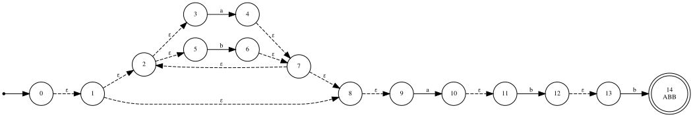
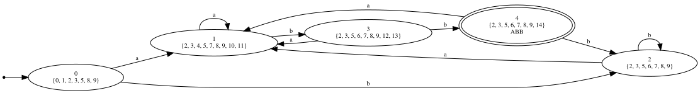
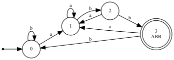
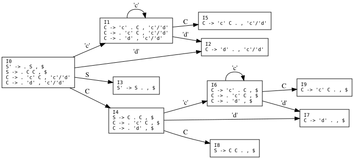
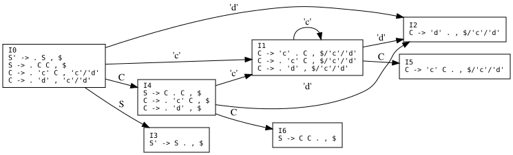
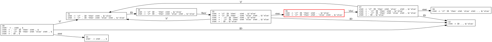

# Algorithms in LALRGen: a viva guide

This document explains every algorithm in the project the way you would explain it to an
examiner: what problem it solves, the steps, a small example traced by hand, where it lives in
the code, and its cost. Every example below was produced by the tool itself, so you can
reproduce it with the command shown.

```
spec.lg ──► SpecParser ──► SpecCompiler ─┬─► regex ─► Thompson NFA ─► subset DFA ─► minimized DFA ─► Lexer
                                         └─► grammar ─► FIRST/FOLLOW ─► LR(0) / LR(1) items ─► LALR merge ─► ACTION/GOTO ─► Parser
```

The punchline for the viva: **the same idea is used twice.** The lexer builds a DFA whose states
are *sets of NFA states*. The parser generator builds a DFA whose states are *sets of LR items*.
Both are built by the same worklist pattern: start from a closure, follow every symbol, add each
new set you discover.

---

## 1. Regex parsing and desugaring

**Problem.** Turn text like `[0-9]+(\.[0-9]+)?` into a tree the automaton builder can walk.

**Steps.** Recursive descent, one method per precedence level
(`RegexParser.parseUnion` → `parseConcat` → `parsePostfix` → `parseAtom`). Sugar is removed while
parsing so later stages only see five node types: `CharSet`, `Concat`, `Union`, `Star`, `Epsilon`.

| Written | Becomes |
|---|---|
| `a+` | `a a*` |
| `a?` | `a \| ε` |
| `a{2,3}` | `a a (a \| ε)` |
| `[a-c]`, `\d`, `.` | one `CharSet` holding code-point ranges |

**Example.** `[0-9]+(\.[0-9]+)?` becomes
`Concat(Concat([0-9], Star([0-9])), Union(Concat(".", Concat([0-9], Star([0-9]))), ε))`.

**Why a CharSet is a set of ranges.** `[^\n]` contains 1,114,111 code points. Storing it as two
ranges `[0..9] ∪ [11..0x10FFFF]` (class `IntervalSet`) keeps it tiny.

**Code.** `regex/RegexParser.java`, `regex/RegexNode.java`, `regex/IntervalSet.java`.
**Cost.** Linear in the regex length; `{m,n}` copies the atom n times (capped at 1000).

---

## 2. Alphabet compression (character classes)

**Problem.** A DFA table with one column per Unicode character would have 1.1 million columns.

**Steps.**
1. Collect every character set used on any NFA edge.
2. Cut the number line at every range boundary; this gives "elementary intervals".
3. Give the same class number to intervals that belong to exactly the same sets (same
   "signature"). Intervals in no set get class -1 (always a dead transition).

**Example.** Sets `[a-z]`, `[0-9a-f]`, `[^\n]` give four classes: `[a-f]`, `[g-z]`, `[0-9]`, and
"every other character except newline". So the DFA needs 4 columns.

**Code.** `automata/CharClasses.java` (test: `MinimizerTest.classesCompressTheAlphabet`).
**Cost.** O(I · S) for I elementary intervals and S sets; lookup of a character's class is a
binary search.

---

## 3. Thompson's construction (regex → NFA)

**Problem.** Build an automaton that accepts exactly the regex's language.

**Steps.** One rule per node type. Each fragment has one start state and one accept state.

```
c       :  (s) --c--> (a)
ε       :  (s) --ε--> (a)
A B     :  A.accept --ε--> B.start
A | B   :  (s) --ε--> A.start, B.start ;  A.accept, B.accept --ε--> (a)
A*      :  (s) --ε--> A.start, (a) ;  A.accept --ε--> A.start, (a)
```

For a lexer, one extra start state gets an ε-edge to every token's fragment, and each fragment's
accept state is **tagged with the token rule's index**, which is also its priority.

**Example.** `(a|b)*abb` (run `lalrgen dot docs/images/abb.lg --what nfa`):



State 0 is the global start, states 1 to 8 are the star of the union, and 9 to 14 spell `abb`.
State 14 is accepting and tagged `ABB`.

**Facts worth quoting.** At most 2 states per regex symbol; at most two outgoing edges per state;
no edge enters the start state; no edge leaves the accept state.

**Code.** `automata/Thompson.java`, `automata/NFA.java`.
**Cost.** O(n) states and edges for a regex of length n.

---

## 4. ε-closure and subset construction (NFA → DFA)

**Problem.** An NFA can be in many states at once and needs backtracking or set simulation to
run. A DFA is in exactly one state, so a lexer can run it with a table lookup per character.

**Steps.**
```
D0 = ε-closure({start})
worklist = [D0]
while worklist not empty:
    take S
    for each character class c:
        T = ε-closure(move(S, c))
        if T is empty: no edge (dead)
        else: if T is new, give it a number and add it to the worklist
              trans[S][c] = T
```
A DFA state accepts if it contains an accepting NFA state. If it contains several (for example
the accept states of `'if'` and `ID` after reading "if"), **the lowest tag wins**: that is how
priority is implemented.

**Example.** For `(a|b)*abb` the tool produces exactly the five states A to E of the dragon book
(our numbers 0 to 4):

| DFA state | NFA states | on a | on b |
|---|---|---|---|
| 0 (A) | {0, 1, 2, 3, 5, 8, 9} | 1 | 2 |
| 1 (B) | {2, 3, 4, 5, 7, 8, 9, 10, 11} | 1 | 3 |
| 2 (C) | {2, 3, 5, 6, 7, 8, 9} | 1 | 2 |
| 3 (D) | {2, 3, 5, 6, 7, 8, 9, 12, 13} | 1 | 4 |
| 4 (E), accepts ABB | {2, 3, 5, 6, 7, 8, 9, 14} | 1 | 2 |



**Viva point.** The worst case is exponential: an n-state NFA can need 2ⁿ DFA states (the classic
example is "the n-th character from the end is a", `(a|b)*a(a|b){n-1}`). In practice lexer
regexes stay small. The test `RegexOracleTest` runs such a regex too.

**Code.** `automata/SubsetConstruction.java` (`NFA.epsilonClosure`, `NFA.move`).
**Cost.** O(2ⁿ · k) worst case for n NFA states and k classes; usually close to linear.

---

## 5. DFA minimization (Hopcroft), and the lexer twist

**Problem.** Merge DFA states that no input can tell apart, giving the smallest equivalent DFA.

**Idea.** Start with a coarse partition of the states and keep splitting a block whenever two of
its states go to different blocks on the same character. When nothing splits, each block is one
state of the minimal DFA.

**The lexer twist (important).** The textbook starts with two blocks, "accepting" and
"non-accepting". For a lexer that is **wrong**: the accept state of `NUM` and the accept state of
`ID` might have identical futures and get merged, and then the lexer could not say which token it
found. LALRGen starts with **one block per token type plus one block for non-accepting states**.
Test: `MinimizerTest.tokenTypesAreNeverMerged`.

**Example** (round by round, which is easy to check by hand; D is the implicit dead state):

| Round | Partition | Why |
|---|---|---|
| 0 | {0,1,2,3,D} {4} | non-accepting vs accepts ABB |
| 1 | {0,1,2,D} {3} {4} | only 3 goes to {4} on b |
| 2 | {0,2,D} {1} {3} {4} | only 1 goes to {3} on b |
| 3 | {0,2} {D} {1} {3} {4} | D goes to D on a, while 0 and 2 go to {1} |
| 4 | stable | |

Dropping the dead block leaves **4 states** (0 and 2, which are A and C in the dragon book, merge):



**Hopcroft vs Moore.** The rounds above are Moore's algorithm: simple, O(n² k).
Hopcroft's algorithm reaches the same partition in O(n k log n) by keeping a worklist of
"splitter" blocks and, after a split, only adding the *smaller* half to the worklist. The tool
uses Hopcroft; Moore is kept as an independent check, and the tests assert both always give the
same number of states.

**Code.** `automata/Minimizer.java` (`hopcroft`, `moore`, `initialPartition`, `quotient`).

---

## 6. Maximal munch and priority (the lexer runtime)

**Problem.** Split the input into tokens when token languages overlap.

**Steps.** From the current position, run the DFA as far as it can go, remembering the last
position where it was in an accepting state. When it gets stuck, emit the token for that last
accepting position and restart there. If no accepting state was ever reached, report an error,
skip a character, and continue (a run of bad characters is reported once).

**Examples** (`LexerTest`):
* `>=>` with tokens `'>'` and `'>='` gives `'>='` `'>'` (longest first).
* `if iffy` gives `'if'` `ID` ("iffy" is longer than "if", so length beats priority).
* `1.` with `NUM = [0-9]+(\.[0-9]+)?` gives `NUM` then `'.'`: the DFA reads "1." hoping for more
  digits, gets stuck, and **backs up** to the last accept after "1".

**Code.** `lexer/Lexer.java`. **Cost.** Usually linear; backing up can make it O(n²) in
pathological token sets.

---

## 7. Nullable, FIRST and FOLLOW

**Problem.** The parser generator needs to know which tokens can start a phrase (FIRST) and which
can come right after a non-terminal (FOLLOW).

**Rules** (applied repeatedly until nothing changes, a *fixed point*):
```
nullable(A)  if A -> X1..Xn with every Xi nullable (n = 0 counts)
FIRST(t)   = {t}
FIRST(A)  ⊇ FIRST(Xi)   for A -> X1..Xn, as long as X1..X(i-1) are nullable
FOLLOW(S') = {$}
A -> α B β :  FOLLOW(B) ⊇ FIRST(β) ;  if β is nullable, FOLLOW(B) ⊇ FOLLOW(A)
```

**Example** (`lalrgen sets examples/expr.lg`):
```
E       FIRST  = { '(', id }    FOLLOW = { $, '+', ')' }
T       FIRST  = { '(', id }    FOLLOW = { $, '+', '*', ')' }
F       FIRST  = { '(', id }    FOLLOW = { $, '+', '*', ')' }
```
Why `')'` ∈ FOLLOW(E): from `F -> '(' E ')'`. Why FOLLOW(T) ⊇ FOLLOW(E): from `E -> T`, where
nothing follows T.

The test `GrammarAnalysisTest.dragonBookFirstAndFollow` checks the dragon book's LL(1) grammar
with ε-rules (E, E', T, T', F) against the sets computed by hand.

**Code.** `grammar/GrammarAnalysis.java`. It also computes reachability, and the *shortest
terminal string* of each non-terminal (used to reject non-productive rules like `t : t 'b' ;` and
to expand conflict examples).
**Cost.** Each pass is linear in the grammar size; the number of passes is bounded by the total
size of the sets.

---

## 8. LR(0) items, closure, goto, and the canonical collection

**Item.** A production with a dot: `E -> E . '+' T` means "an E has been seen, `'+' T` is
expected next".

**closure(I).** If the dot is before a non-terminal B, the parser might be about to see a B, so
add `B -> . γ` for every B production, and repeat.

**goto(I, X).** Move the dot over X in every item that allows it, then take the closure.

**Canonical collection.** Start from `closure({S' -> . S})` and, breadth-first, apply goto with
every symbol; each new item set becomes a state. Kernel items (dot not at the far left, plus the
start item) determine the state; closure items are derived (shown with `+` below).

**Example** (`lalrgen states examples/expr.lg --mode slr`):
```
State 0                        State 3
    E' -> . E                      E' -> E .
  + E -> . E '+' T                 E -> E . '+' T
  + E -> . T                       on '+' -> 7
  + T -> . T '*' F
  + T -> . F                   State 4
  + F -> . '(' E ')'               E -> T .
  + F -> . id                      T -> T . '*' F
    on '(' -> 1                    on '*' -> 8
    on id -> 2
    on E -> 3 ...
```
The expression grammar has **12 LR(0) states**, the dragon book's I0 to I11.

**The key insight.** This automaton is a DFA over grammar symbols. It recognises *viable
prefixes*: the stack contents that can still lead to a successful parse. The LR parser is just
this DFA plus a stack, so it never has to rescan the stack.

**Code.** `lr/AutomatonBuilder.java` (`closure`, `build`), `lr/LR0Item.java`, `lr/LRState.java`.

---

## 9. SLR(1) tables, and their weakness

**Table rules.**
```
[A -> α . t β] in state I     ⇒  ACTION[I][t] = shift goto(I, t)
[A -> α .]     in state I     ⇒  ACTION[I][a] = reduce A -> α   for every a in FOLLOW(A)
[S' -> S .]    in state I     ⇒  ACTION[I][$] = accept
goto(I, A) = J                ⇒  GOTO[I][A] = J
```

**Example** (`lalrgen tables examples/expr.lg --mode slr`):
```
      | ACTION                 | GOTO
state | $   '+' '*' '(' ')' id | E T  F
------+------------------------+--------
0     |             s1      s2 | 3 4  5
2     | r6  r6  r6      r6     |
3     | acc s7                 |
4     | r2  r2  s8      r2     |
...
```
State 4 holds `E -> T .` and `T -> T . '*' F`. On `'*'` it shifts; on FOLLOW(E) = {$, '+', ')'}
it reduces. No overlap, so no conflict.

**Weakness.** FOLLOW(A) is everything that can follow A *anywhere*, not *here*.
`examples/not_slr.lg` (dragon book 4.48) shows it:
```
S : L '=' R | R ;     L : '*' R | id ;     R : L ;

Conflict in state 4 on lookahead '=' (shift/reduce)
  Shift:   S -> L . '=' R
  Reduce:  R -> L .
  Example: after reading  L   with next token '='
```
'=' ∈ FOLLOW(R) because of `L -> '*' R` and `S -> L '=' R`, but in state 4, the start of the
input, an R could only be followed by $. SLR cannot see that; LR(1) can.

**Code.** `lr/TableBuilder.java` (mode `SLR` uses `analysis.follow`).

---

## 10. Canonical LR(1)

**Item.** An LR(0) item plus one lookahead terminal: `[A -> α . β, a]` means "and after this A,
the next token will be a". The parser only reduces `A -> α .` when the next token is `a`.

**Closure with lookaheads.** For `[A -> α . B β, a]` add `[B -> . γ, b]` for every
**b ∈ FIRST(β a)**. That is the whole difference from LR(0). LALRGen stores a state as
"core item → set of lookaheads", and re-processes an item whenever its set grows.

**Example** (`lalrgen states examples/cc.lg --mode lr1`, grammar `S : C C ; C : 'c' C | 'd' ;`):
```
State 0
    S' -> . S        [$]
  + S -> . C C       [$]
  + C -> . 'c' C     ['c', 'd']     <- FIRST(C $) = {'c','d'}: a second C follows
  + C -> . 'd'       ['c', 'd']
State 4
    S -> C . C       [$]
  + C -> . 'c' C     [$]            <- FIRST($) = {$}: nothing follows the second C
  + C -> . 'd'       [$]
```
So after reading `'d'` the parser lands in state 2 (`C -> 'd' .` on c/d) if it is the first C,
and state 7 (`C -> 'd' .` on $) if it is the second. Same core, different lookaheads:
**10 LR(1) states** against 7 LR(0) states.



**Cost.** Precise, but grammars of real languages get thousands of states
(minic: 213 LR(1) states against 101 LALR).

**Code.** `AutomatonBuilder.buildLR1`, `closure` (the `firstAfter` / `nullableAfter` arrays
precompute FIRST(β) for every item position).

---

## 11. LALR(1) by merging

**Steps.** Build the canonical LR(1) collection, then merge every group of states with the same
**core** (same LR(0) items), taking the union of lookaheads. Edges stay consistent because goto
depends only on the core. You get the LR(0) number of states with (almost) LR(1) precision.
This is what Yacc and Bison build.

**Example.** In the cc grammar the pairs (1, 6), (2, 7) and (5, 9) merge:
```
State 2 (LALR)
    C -> 'd' .    [$, 'c', 'd']
```
**7 LALR states**, exactly as many as LR(0), and still no conflicts.



**Why merging can add reduce/reduce conflicts but never shift/reduce ones** (a viva favourite).
Shift actions depend only on the core, and merged states have the same core. Suppose a merged
state had a new shift/reduce conflict on t: a reduce item with lookahead t came from some original
state P. Because P has the same core, P also had the shift on t, so P already had the conflict.
Reductions are different: two reduce items from two different states can pick up the same
lookahead after the union.

`examples/not_lalr.lg` (dragon book 4.58) is that case:
```
S : 'a' A 'd' | 'b' B 'd' | 'a' B 'e' | 'b' A 'e' ;   A : 'c' ;   B : 'c' ;

LR(1):  {A -> 'c' . , d}  {B -> 'c' . , e}     after 'a' 'c'
        {A -> 'c' . , e}  {B -> 'c' . , d}     after 'b' 'c'
LALR:   {A -> 'c' . , d/e}  {B -> 'c' . , d/e}  merged: reduce/reduce on 'd' and on 'e'
```
`lalrgen compare examples/not_lalr.lg` prints LR(1) 14 states, 0 conflicts; LALR 13 states,
2 reduce/reduce.

**Code.** `lr/LalrMerger.java`. The faster DeRemer and Pennello algorithm computes the same
lookaheads without building the LR(1) collection; merging was chosen because it is the easiest
to explain and verify.

---

## 12. Precedence and associativity

**Problem.** `expr : expr '+' expr | expr '*' expr | NUM ;` is ambiguous, so its table has
shift/reduce conflicts. Instead of rewriting the grammar, declare precedence.

**Rules** (Yacc's):
* A production's precedence = its `%prec` token's, else its rightmost terminal's.
* Shift/reduce between token t and production p, both with precedence:
  higher wins; equal: `%left` → reduce, `%right` → shift, `%nonassoc` → error entry.
* Anything else: shift, and warn. Reduce/reduce: the earlier production, and warn.

**Example.** `1 - 2 - 3` in calc (`lalrgen check examples/calc.lg --verbose`):
```
Resolved conflict in state 24 on lookahead '-' (shift/reduce)
  Shift:   expr -> expr . '-' expr
  Reduce:  expr -> expr '-' expr .
  Chosen:  reduce expr -> expr '-' expr
  Why:     equal precedence and '-' is %left
```
so the trace reduces `1 - 2` before shifting the second '-', giving `(1 - 2) - 3`.
For `1 + 2 * 3` the cell (after `expr '+' expr`, lookahead '*') shifts because '*' was declared
on a later line, giving `1 + (2 * 3)`. `-2 * 3` uses `%prec UMINUS` so the unary minus binds
tighter than '*'.

**Code.** `TableBuilder.resolve`. Tests: `PrecedenceTest`.

---

## 13. Explaining conflicts: shortest viable prefix

**Problem.** "Conflict in state 47" means nothing to a person. Show an input that gets there.

**Steps.** Breadth-first search over the automaton from state 0; the BFS tree gives the
**shortest** symbol sequence reaching each state (a shortest viable prefix). With `--expand`,
each non-terminal in it is replaced by its shortest terminal string (from section 7).

**Example** (`lalrgen check examples/dangling_else.lg --expand`):
```
Conflict in state 6 on lookahead 'else' (shift/reduce)
  Shift:   stmt -> 'if' ID 'then' stmt . 'else' stmt
  Reduce:  stmt -> 'if' ID 'then' stmt .
  Example: after reading  'if' ID 'then' ID   with next token 'else'
  Chosen:  shift, go to state 7
```
States with unresolved conflicts are drawn in red by `dot --what lalr`:



**Code.** `LRAutomaton.shortestPrefix`, `TableFormatter.conflicts`.

---

## 14. The shift-reduce driver and panic-mode recovery

**Driver.**
```
stack = [0]
loop:  s = top state;  a = next token
       ACTION[s][a] = shift t   → push t, read the next token
                    = reduce p  → pop |rhs(p)| states, push GOTO[top][lhs(p)], build a tree node
                    = accept    → done
                    = blank     → syntax error
```

**Example** (`lalrgen parse examples/expr.lg input --trace --mode slr`, input `id + id * id`):
```
step  stack                        input               action
1     0                            id '+' id '*' id $  shift 2
2     0 id 2                       '+' id '*' id $     reduce F -> id
3     0 F 5                        '+' id '*' id $     reduce T -> F
4     0 T 4                        '+' id '*' id $     reduce E -> T
5     0 E 3                        '+' id '*' id $     shift 7
...
9     0 E 3 '+' 7 T 10             '*' id $            shift 8        <- '*' binds tighter: shift
...
12    0 E 3 '+' 7 T 10 '*' 8 F 11  $                   reduce T -> T '*' F
13    0 E 3 '+' 7 T 10             $                   reduce E -> E '+' T
14    0 E 3                        $                   accept
```
Reading the reductions bottom-up gives a rightmost derivation in reverse; that is what "LR"
means (Left-to-right scan, Rightmost derivation in reverse).

**Error messages.** The "expected" list is every terminal with a non-error action in the
current state: `unexpected '*', expected one of: '(', id`.

**Panic-mode recovery.**
1. Report the error.
2. Skip input tokens until a synchronizing token (`';'`, `'}'`, or the `%sync` list) or the end.
3. Pop states until the top state has an action for that token, and resume.
4. If no state on the stack can use it, discard it and go back to step 2.
5. To guarantee progress, a repeated error at the same token with no shift in between is not
   reported again and the token is discarded. Parsing stops after 20 errors.

**Example** (`lalrgen parse examples/calc.lg examples/inputs/calc_bad.txt`):
```
calc_bad.txt:1:8: error: unexpected ';', expected one of: '-', '(', NUM, ID
calc_bad.txt:3:5: error: unexpected ')', expected one of: '-', '(', NUM, ID
calc_bad.txt:4:7: error: unexpected character "$"
calc_bad.txt:4:9: error: unexpected NUM "5", expected one of: ';', '+', '-', ...
```
All four errors are found in one run.

**Code.** `runtime/Parser.java`. Each step is O(1), so parsing is linear in the input length.

---

## Where everything lives

| Concept | Class |
|---|---|
| Spec syntax | `spec/SpecParser` |
| Semantic checks, building lexer + grammar | `core/SpecCompiler` |
| Regex AST, desugaring | `regex/RegexParser`, `regex/RegexNode` |
| Character sets, alphabet compression | `regex/IntervalSet`, `automata/CharClasses` |
| Thompson | `automata/Thompson` |
| Subset construction | `automata/SubsetConstruction` |
| Minimization | `automata/Minimizer` |
| Maximal munch | `lexer/Lexer` |
| Nullable, FIRST, FOLLOW | `grammar/GrammarAnalysis` |
| Items, closure, goto | `lr/AutomatonBuilder`, `lr/LR0Item`, `lr/LRState` |
| LALR merge | `lr/LalrMerger` |
| Table + conflict resolution | `lr/TableBuilder` |
| Driver, AST, recovery | `runtime/Parser`, `runtime/Node` |
| Reports, DOT, JSON, Bison export | `viz/*` |

---

## Common viva questions

**What is the difference between an NFA and a DFA?**
An NFA may have several transitions on the same character and ε-transitions, so it can be in many
states at once. A DFA has exactly one transition per state and character. They accept the same
class of languages (the regular languages); a DFA is faster to run, an NFA is easier to build
from a regex.

**Why can subset construction blow up?** Each DFA state is a *subset* of NFA states, and there
are 2ⁿ subsets. `(a|b)*a(a|b){n-1}` needs 2ⁿ DFA states because the DFA must remember the last n
characters.

**Why can't the lexer's minimizer start from accepting vs non-accepting?** Because accepting
states of different tokens would be merged. The initial partition must separate token types.

**Why longest match, and why priority?** Longest match makes `>=` one token and `iffy` an
identifier. Priority breaks ties of equal length, so the keyword `if` beats `ID` on exactly "if".

**What is a viable prefix?** A prefix of a right-sentential form that does not extend past the
right end of the handle; in practice, any stack content that can still lead to an accepted input.
The LR(0) automaton recognises exactly the viable prefixes.

**What is a handle?** The right-hand side that the parser should reduce next, in the position
where reducing it is a step of the rightmost derivation (in reverse).

**Why is the expression grammar SLR but `S -> L = R | R` is not?** SLR reduces on FOLLOW of the
left side. In the expression grammar the FOLLOW sets never overlap the shift symbols in the same
state. In the L/R grammar, '=' ∈ FOLLOW(R), so in the state with `S -> L . = R` and `R -> L .` SLR
both shifts and reduces on '='. LR(1) knows that at that point R could only be followed by $.

**Why do Yacc and Bison use LALR and not canonical LR(1)?** LALR tables are as small as SLR
(same number of states as LR(0)) but handle almost every practical grammar LR(1) handles. LR(1)
tables can be several times larger.

**Can LALR merging create conflicts?** Only reduce/reduce, never shift/reduce (see section 11),
and `not_lalr.lg` demonstrates it.

**How does the parser handle `1 - 2 - 3`?** The grammar is ambiguous; the table cell after
`expr '-' expr` with lookahead '-' has both shift and reduce. '-' is `%left` and both sides have
equal precedence, so the cell becomes reduce, giving `(1 - 2) - 3`.

**How does the dangling else get resolved?** Default shift: the `else` attaches to the nearest
`if`, as in C and Java. `dangling_else_prec.lg` makes this explicit with `%prec` so no warning is
printed.

**How do you know the tables are right?** Four independent checks: textbook state counts in the
tests (12, 10/7, 22), a property test that LALR and LR(1) tables accept exactly the same token
strings, a property test that every lexer stage agrees with `java.util.regex` on thousands of
strings, and `scripts/bison_compare.sh`, which compares LALR state counts and conflict counts with
GNU Bison on every example.

**What is the time complexity of parsing?** Linear in the number of tokens: each token is shifted
once, and each reduction pops what was pushed.
